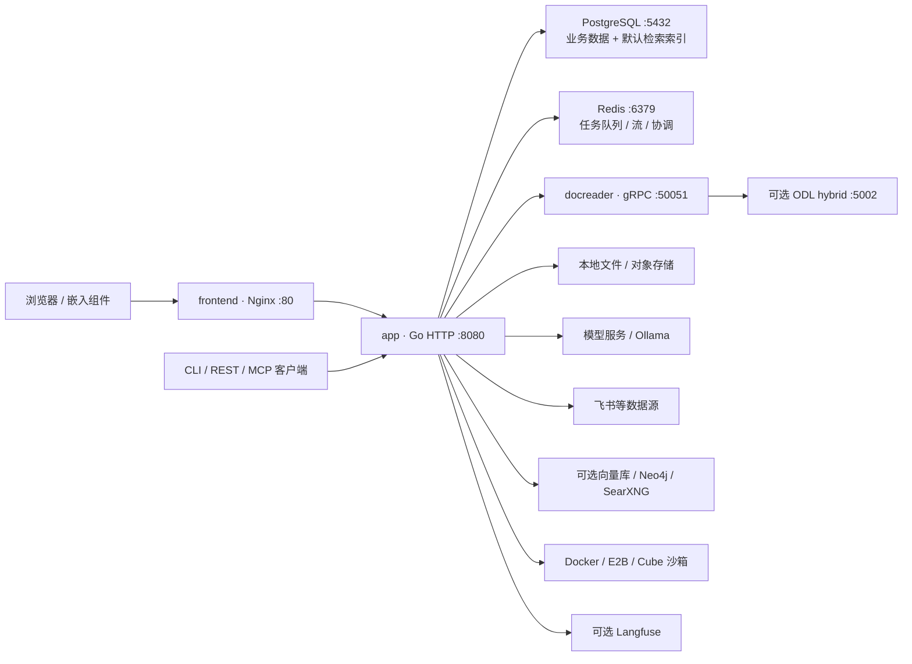

# WeKnora 仓库分析

分析对象：`D:/BoyanKB/WeKnora`，分支 `develop`，提交 `3e8b0bfc`，`git describe --tags --always` 返回 `v0.8.2`。分析日期：2026-10-08（Asia/Shanghai）。以下路径均相对仓库根目录，行号对应本次检出版本。

本报告依据当前源码、部署模板、示例配置和已有测试的静态阅读。唯一写入是新建本文件；未读取真实 `.env` 或部署密钥文件，未安装依赖、构建、运行测试、启动服务、执行迁移、切换分支或提交。实际部署配置、数据库状态、浏览器显示及外部服务连通性均未验证。后文命令是后续验证建议，本次没有执行；需要写缓存、创建测试数据或访问外部服务的验证应在另行授权的隔离环境完成。

## 1. 整体架构

### 1.1 服务及依赖

默认标准部署是 Vue 前端、Go 主应用、Python 文档解析服务、PostgreSQL、Redis 五个常驻服务。任务消费、数据源调度、RAG、Agent、权限判断均在 app 内，不是独立的 worker 微服务。其他服务由 Compose profile 或外部连接配置启用。



下面的端口是模板默认值，不代表本机已监听。`宿主机 → 容器` 表示 Compose 的发布端口；“内部”表示标准 Compose 没有发布到宿主机。

| 服务 | 职责、依赖 | 标准 Compose 默认端口及启用条件 |
| --- | --- | --- |
| `frontend` | Vue 3、TypeScript、Vite、Pinia、TDesign；Nginx 提供静态页面并代理 REST、SSE、WebSocket、嵌入页、MCP | `80 → 80`，由 `FRONTEND_PORT` 改宿主机端口；等待 app 健康 |
| `app` | Go 1.26、Gin、GORM、依赖注入；认证、空间、知识库、Agent、模型、导入/检索、API、后台任务 | `8080 → 8080`，由 `APP_PORT` 改宿主机端口；等待 postgres/docreader 健康及 redis 启动 |
| `docreader` | Python gRPC；文档转换、PDF/Office/网页解析及可配置 OCR/多模态解析 | 内部 `50051`；app 通过 `DOCREADER_ADDR=docreader:50051` 调用；共享 `docreader-tmp` 卷，app 只读挂载 |
| `postgres` | 业务元数据、用户/空间/权限、知识/分块/会话；默认 PostgreSQL 检索后端，支持向量与全文检索 | 内部 `5432`；镜像 `paradedb/paradedb:v0.22.6-pg17`；`postgres-data` 持久化 |
| `redis` | Asynq 任务、Redis stream 模式、分布式协调及系统设置通知 | 内部 `6379`；镜像 Redis 7；`REDIS_ADDR` 决定是否采用分布式任务队列 |
| 本地文件存储 | 原始上传、导入文件及应用产物；不是独立服务 | 默认 `STORAGE_TYPE=local`，app 的 `/data/files` 对应 `data-files` 卷 |
| `minio` | 可选 S3 兼容对象存储 | `9000 → 9000`、控制台 `9001 → 9001`；profile `minio` 或 `full` |
| `neo4j` | 可选知识图谱数据库 | HTTP `7474 → 7474`、Bolt `7687 → 7687`；profile `neo4j` 或 `full` |
| `qdrant` | 可选向量检索后端 | REST `6333 → 6333`、gRPC `6334 → 6334`；profile `qdrant` 或 `full` |
| `milvus` | 可选向量检索后端 | `19530 → 19530`、健康端口 `9091 → 9091`；profile `milvus` |
| `weaviate` | 可选检索后端 | HTTP `9035 → 8080`、gRPC `50052 → 50051`；profile `weaviate` |
| `doris-fe` / `doris-be` | 可选 Doris 检索集群；BE 依赖 FE | FE `8030 → 8030`、SQL `9030 → 9030`；BE `8040 → 8040`；profile `doris` |
| `searxng-init` / `searxng` | 一次性初始化搜索配置，然后提供联网搜索 | 默认绑定 `127.0.0.1:8888 → 8080`；profile `searxng` 或 `full` |
| `odl-hybrid` | docreader 可选的 OpenDataLoader hybrid PDF 辅助服务 | 内部 `5002`；profile `odl-hybrid` |
| `sandbox` | 构建/准备技能运行镜像；Compose 命令为 `true`，并非常驻执行服务 | 无端口；profile `full`；实际会话沙箱由 app 经 Docker/E2B/Cube 创建 |
| `dex` | 可选 OIDC 身份提供方示例 | `5556 → 5556`；profile `dex` 或 `full`；实际企业 IdP 可外置 |
| Langfuse 组合 | 可选 LLM/Agent 调用追踪；web、worker 依赖 PostgreSQL、Redis、ClickHouse、专用 MinIO；另有一次性 DB 初始化 | web `3000 → 3000`；专用 MinIO `9100 → 9000`、`9101 → 9001`；profile `langfuse` 或 `full` |
| `mcp` | 兼容保留的 Python MCP 服务，通过 REST 调 app；仓库文档已标记弃用 | `8082 → 8000`；profile `full`；需要独立传输认证配置 |
| app 内置 MCP | 当前空间可发布 `/mcp/:endpoint_id`，独立端点令牌、知识库范围及工具配置 | 与 app 共用 `8080`，Nginx 代理 `/mcp/`；无需另起 Python MCP 服务 |
| 外部模型服务 | Chat、Embedding、Rerank、Vision 等推理 | 提供商 URL 决定；Ollama 模板默认 `host.docker.internal:11434`，Compose 不包含 Ollama 服务 |

主要证据：`docker-compose.yml:2`、`:36`、`:380`、`:395`、`:407`、`:514`、`:531`、`:552`、`:565`、`:612`、`:635`、`:656`、`:671`、`:699`、`:738`、`:777`、`:809`、`:1008`；`internal/router/router.go:191`；`frontend/nginx.conf:197`；`README_CN.md:279`。

### 1.2 代码分层与主要数据流

| 层 | 路径 | 职责 |
| --- | --- | --- |
| 启动/装配 | `cmd/server/main.go`、`cmd/server/bootstrap.go`、`internal/container/container.go` | 加载配置、初始化数据库/检索/存储、注册服务与任务、启动 HTTP |
| 接口与授权 | `internal/router/`、`internal/handler/`、`internal/middleware/`、`internal/application/access/` | API 路由、参数校验、认证、RBAC、具体资源访问判断 |
| 业务与持久化 | `internal/application/service/`、`internal/application/repository/`、`internal/types/` | 业务编排、数据库访问及数据模型 |
| RAG/Agent | `internal/application/service/chat_pipeline/`、`internal/agent/engine.go` | 查询理解、检索、合并、rerank、回答及工具调用 |
| 解析与外部数据 | `internal/infrastructure/docparser/`、`docreader/`、`internal/datasource/` | 内置/远程解析器、Python 解析、连接器与同步调度 |
| 后台任务与流 | `internal/router/task.go`、`internal/stream/` | Asynq 多类 worker pool、后台处理及聊天事件流 |
| 数据结构升级 | `migrations/`、`internal/container/container.go:887` | 启动时可自动执行迁移；本次没有启动 app |
| Web/客户端 | `frontend/`、`cli/`、`client/`、`cmd/desktop/`、`miniprogram/` | Web UI、独立 Go CLI/SDK、Wails 桌面端、小程序 |
| 独立文档站 | `website-docs/.vitepress/`、`website-docs/homepage/` | VitePress 文档及 Next.js 官网；不属于标准 Compose 的 frontend 页面 |

导入链路：上传/URL/数据源 → 保存知识记录与文件 → app 入队并消费任务 → 选定解析器或 docreader → 分块、embedding、索引及可选摘要/图谱/Wiki。问答链路：认证及知识库授权 → 检索/Agent 工具调用 → 模型生成 → 流式返回和会话持久化。部分格式能经 Go 内置 anydoc/simple 转换，不是每份文档都必须经过 Python。

`DB_DRIVER` 当前实际初始化分支只有 `postgres` 和 `sqlite`，见 `internal/container/container.go:790`；即使仓库存在 `migrations/mysql/`，也不能据此宣称当前 app 已支持 MySQL 作为业务主库。检索数据库与业务主库是不同配置，`RETRIEVE_DRIVER` 可选择不同后端或多个后端，不能将 Milvus/Qdrant 等替代向量库理解为替代业务表。

开发部署 `docker-compose.dev.yml` 主要提供依赖服务，额外发布 PostgreSQL `5432`、Redis `6379`、docreader `50051` 等端口；前端 Vite 默认 `5173`，代理 `8080`，见 `frontend/vite.config.ts:141`。标准部署 Nginx 使用 `APP_HOST`、`APP_SCHEME`、`APP_BACKEND_PORT` 指定后端，宿主机映射 `APP_PORT` 与容器内监听端口不是同一个概念。

Lite 使用 SQLite、本地文件及进程内能力，可不配置 Redis/docreader；不能直接把它当作默认多服务部署。Redis 缺省时任务装配改用 `SyncTaskExecutor`，见 `internal/container/container.go:438`；聊天流是否用 Redis 另由 `STREAM_MANAGER_TYPE` 控制，见 `internal/stream/factory.go:18`。Lite 的产品能力边界见 `docs/LITE.md`。

**未验证及验证方法：**本机实际启用的 profile、宿主机端口、镜像版本、依赖健康及数据卷状态均未验证。后续可在已运行的测试部署执行 `docker compose ps`、请求 `GET /health`、检查一次测试文档的解析及问答；本次没有启动容器。镜像模板默认版本是 `latest`，不能仅由源码 tag 推断实际镜像内容。`/health` 返回应用健康响应，不足以代替所有依赖的读写验收。

## 2. 品牌相关位置清单

### 2.1 产品页面和资源

| 品牌位置 | 具体文件 | 定制入口及注意点 |
| --- | --- | --- |
| 主 Logo 图 | `frontend/src/assets/img/weknora.png` | 当前是图片资源，名称可能已在图内；只替换文字文案不会替换它 |
| 侧栏 Logo / Lite 标识 | `frontend/src/components/menu.vue:6` | Logo 图片引用与 `Lite` 标识 |
| 登录/注册页 Logo、官方站及 GitHub | `frontend/src/views/auth/Login.vue:99` | Logo alt、页头链接、宣传轮播、登录/注册文案及页底表单链接 |
| 登录轮播图 | `frontend/src/assets/img/screenshot-1.svg`、`frontend/src/assets/img/screenshot-2.svg`、`frontend/src/assets/img/screenshot-3.svg`、`frontend/src/assets/img/screenshot-4.svg` | Login.vue 直接导入四张图；图片内文字也需核对 |
| README / 功能说明截图 | `docs/images/` | 图片本身可能包含旧品牌；具体引用见各 README 和功能文档 |
| 主页面 title / SEO description | `frontend/index.html:4`、`:13` | 静态 `WeKnora` 标题及产品描述；主应用未发现统一运行时品牌标题配置 |
| favicon / Apple touch icon | `frontend/public/favicon.ico`、`frontend/index.html:14` | 两处 link 都引用同一资源；构建后实际 URL 未验证 |
| 首页宣传和对话欢迎语 | `frontend/src/views/platform/index.vue`、`frontend/src/views/chat/index.vue`、`frontend/src/i18n/locales/zh-CN.ts:2708`、`:4840` | 模板主要取 i18n；品牌名还出现在引导、设置、集成和示例内容中 |
| 用户菜单文档 / GitHub 入口 | `frontend/src/components/UserMenu.vue:496`、`:502` | 指向上游 `website-docs` 和 GitHub 仓库 |
| 系统信息、版本、问题反馈 | `frontend/src/views/settings/SystemInfo.vue:249` | 迁移帮助及 GitHub issue 链接；版本取包/构建信息 |
| 品牌色和组件样式 | `frontend/src/assets/theme/theme.css`、`frontend/src/assets/theme/tdesign-overrides.less` | 全局 TDesign 品牌色；组件内还有局部颜色，不能保证改一个变量覆盖全部 |
| 五种语言 | `frontend/src/i18n/locales/zh-CN.ts`、`en-US.ts`、`ja-JP.ts`、`ko-KR.ts`、`ru-RU.ts` | 以上五个文件都在同一 `locales/` 目录；重点核对 auth、platform、welcome、onboarding、settings、integration 等文案 |
| 语言选择和默认语言 | `frontend/src/i18n/index.ts`、`frontend/src/i18n/resolveDefaultLocale.ts`、`frontend/docker-entrypoint.sh` | 既有用户选择优先；支持运行时 `DEFAULT_LOCALE` 和构建期 `VITE_DEFAULT_LOCALE`，这不是品牌名称配置 |
| FAQ / 分块示例中的品牌 | `frontend/src/views/knowledge/components/FAQEntryManager.vue:2232`、`frontend/src/views/knowledge/settings/chunkingSamples.ts` | 默认示例问题、答案及演示文本仍含 WeKnora |
| 模型服务品牌 | `frontend/src/views/settings/WeKnoraCloudSettings.vue`、`frontend/src/utils/weknoraCloudModels.ts`、`frontend/src/components/ModelEditorDialog.vue` | WeKnora Cloud 同时是实际服务提供方名称及 URL，不能只作装饰文字批量替换 |
| 内置 Agent/提示词 | `config/builtin_agents.yaml`、`config/agent_type_presets.yaml`、`config/prompt_templates/` | 默认名称、介绍、提示词也需纳入企业文案核对 |

主 Web 应用未检出统一的 `Powered by` / 版权页脚组件；`Login.vue:313` 的 `form-footer` 是返回登录链接，许多其他 footer 只是对话框按钮区，不能视作品牌版权页脚。**浏览器实际页脚及各语言的显示情况未验证**，需登录/未登录分别巡检。

### 2.2 指向官方文档、GitHub 和生态的入口

| 文件 | 链接用途 |
| --- | --- |
| `frontend/src/views/auth/Login.vue` | `https://weknora.weixin.qq.com`、上游 GitHub |
| `frontend/src/components/UserMenu.vue` | 上游仓库及其 `website-docs` |
| `frontend/src/views/integrations/ApiIntegrationSettings.vue:1434` | `website-docs/04-api/01-api-overview.md` |
| `frontend/src/views/integrations/CliIntegrationLanding.vue:84`、`:106` | clone/build 示例、CLI README |
| `frontend/src/views/integrations/IntegrationSettingsSection.vue:10` | IM 接入文档 |
| `frontend/src/views/settings/TenantMembers.vue:57` | 空间与认证文档 |
| `frontend/src/views/settings/ModelSettings.vue:30` | 模型文档 |
| `frontend/src/components/ModelEditorDialog.vue:707` | 模型协议兼容配置文档 |
| `frontend/src/views/knowledge/settings/GraphSettings.vue:590` | 知识图谱文档；已有 `VITE_KG_GUIDE_URL` 覆盖入口 |
| `frontend/src/views/settings/SandboxSettings.vue:241`、`frontend/src/components/SandboxConfigEditorDrawer.vue:819` | 沙箱部署文档 |
| `frontend/src/views/settings/BrowserConnectionSettings.vue:29` | Tencent/BrowserSkill 上游及浏览器扩展 |
| `frontend/src/config/integrations.ts`、`frontend/src/views/integrations/ClawSkillLanding.vue` | ClawHub 的 WeKnora Skill 及安装命令 |
| `frontend/src/views/knowledge/settings/DataSourceEditorDialog.vue` | 飞书/Lark 官方权限说明，属于第三方服务说明链接 |

现有品牌入口多数直接写在 Vue/HTML/i18n 中，未发现统一 `BRAND_NAME`、Logo URL、所有文档 URL 的环境变量入口。最小定制应先使用已有覆盖项和资源替换，再考虑集中品牌配置；不应全仓替换 `WeKnora`，因为 Go module、SDK 全局对象、存储 key、API 头、镜像名和第三方产品名称还有兼容性含义。

### 2.3 Embed widget、API 文档及其他分发物

| 场景 | 具体文件 | 可配置部分 / 固定部分 |
| --- | --- | --- |
| Widget JS | `frontend/public/weknora-widget.js:29`、`:34`、`:412` | `title`、`primaryColor`、position 等可传；默认标题 `AI Assistant`，默认色 `#07C05F`；全局对象 `WeKnora`、文件名和 postMessage source 为固定协议 |
| Embed HTML | `frontend/embed.html:4`、`frontend/src/embed-main.ts` | 静态初始 title 是 `WeKnora Embed` |
| Embed 页面与聊天 | `frontend/src/views/embed/EmbedPage.vue:130`、`:170`、`EmbedChatView.vue`、`EmbedChatCore.vue` | channel page title、名称、Agent 名称、欢迎语、头像、颜色等参与呈现；加载后可动态改 document.title |
| 发布设置 | `frontend/src/components/AgentEmbedChannelPanel.vue:209` | 已有 page_title、header_title_mode、primary_color、welcome_message 等配置，企业嵌入外观优先用这些配置 |
| Embed API / 文案 / 域名 | `frontend/src/api/embed/index.ts`、`frontend/src/i18n/embed.ts`、`frontend/src/i18n/locales/embed/index.ts`、`frontend/src/utils/embedBaseUrl.ts` | 嵌入有独立文案和 `VITE_EMBED_BASE_URL`；需与主站分别验收 |
| Embed 静态路由 | `frontend/vite.config.ts`、`frontend/nginx.conf` | 单独构建 embed.html，发布 widget 文件及 `/embed/`；改文件名需同步路由和集成示例 |
| Swagger 标题与联系信息源 | `cmd/server/main.go:4` | `WeKnora API`、说明、GitHub contact；属于现有 Swagger 注解来源，本次没有修改或新增代码注释 |
| Swagger 生成物 | `docs/docs.go`、`docs/swagger.json`、`docs/swagger.yaml` | 不能只改一个生成物就认为源配置已一致 |
| Swagger 页面开关 | `internal/router/router.go:150`、`frontend/nginx.conf` | `/swagger/*any` 只在非 release 模式注册；Compose 默认 `GIN_MODE=release`；Nginx 默认无 `/swagger/` 专用代理，需区分 app 地址与前端地址；API 集成帮助按钮主要打开 Markdown 文档 |
| 文档站 title / favicon / 页脚 | `website-docs/.vitepress/config.mts:75`、`:91`、`:176`、`website-docs/public/favicon.ico` | 固定产品标题、官方描述、MIT 说明及 `© Tencent WeKnora` |
| 文档站页头 | `website-docs/.vitepress/theme/SiteHeader.vue`、`website-docs/shared/header.ts` | Logo、导航、GitHub 链接 |
| 官网 title / Logo / 页脚 | `website-docs/homepage/app/layout.tsx`、`brand-logo.tsx`、`page.tsx`、`interactive.tsx` | 同一 app 目录的 SEO、品牌图片引用、页头及页脚 |
| 官网资源 | `website-docs/homepage/public/brand/weknora-original.png`、`website-docs/homepage/app/favicon.ico` | 与产品 frontend 的 Logo/favicon 是不同副本 |
| 桌面端 | `cmd/desktop/main.go`、`cmd/desktop/wails.json`、`cmd/desktop/build/appicon.png`、`cmd/desktop/build/darwin/Info.plist`、`cmd/desktop/build/windows/installer/project.nsi` | 窗口标题、关于页、图标、安装与系统标识 |
| 小程序 | `miniprogram/app.json:8`、`miniprogram/pages/index/index.wxml` | 导航标题及独立页面 |
| 分发与版权 | `README.md`、`README_CN.md`、`README_JA.md`、`README_KO.md`、`docs/images/logo.png`、`LICENSE` | README 和展示图片也是品牌入口；必须保留 LICENSE、上游及第三方版权声明 |

**未验证及验证方法：**在后续测试构建中分别检查登录页、空间首页、五种语言、API 帮助、独立 embed、SDK 浮窗、文档站和桌面端；检查 Network 中 favicon/Logo 请求及初始/加载后 title。现有 locale 校验可用 `npm --prefix frontend run check-i18n`，但它只能核对文案结构，不能证明所有旧品牌已替换。本次未构建或执行该命令。

## 3. 飞书数据源

### 3.1 实现、配置及权限

实际注册的类型是 `feishu`、`lark`、`feishu_drive`、`lark_drive`，见 `internal/container/container.go:1848`。前两者导入 Wiki 空间/节点，后两者导入指定云盘文件夹及子树。云盘必须选择具体文件夹，不支持留空当根目录。

| 功能 | 文件 |
| --- | --- |
| Wiki / Drive 连接器 | `internal/datasource/connector/feishu/wiki/connector.go`、`internal/datasource/connector/feishu/drive/connector.go` |
| Token、目录枚举、导出/下载 | `internal/datasource/connector/feishu/core/client.go` |
| 共用同步、配置、blocks | `internal/datasource/connector/feishu/core/engine.go`、`shared.go`、`blocks.go`、`types.go`（均位于同一 core 目录） |
| 应用编排和调度 | `internal/application/service/datasource_service.go`、`internal/datasource/scheduler.go` |
| 数据及凭据模型 | `internal/types/datasource.go`、`internal/handler/datasource_credentials.go` |
| 界面及文档 | `frontend/src/views/knowledge/settings/DataSourceEditorDialog.vue:523`、`website-docs/03-features/10-datasource.md`、`website-docs/03-features/24-feishu-drive.md` |

认证使用企业自建应用 `app_id` / `app_secret` 换取 `tenant_access_token`，不是用户 OAuth。飞书/Lark 默认 API 域名分别是 `https://open.feishu.cn` 和 `https://open.larksuite.com`；支持 `base_url`。连接器配置落在 `data_sources.config`，选定范围位于 `config.resource_ids`；可选 `config.settings.timezone` 用于 Bitable 日期渲染。没有发现从 `.env` 自动创建这些数据源及注入应用凭据的 seed 机制。

| 类型 | 仓库 UI 声明的应用权限 | 代码实际操作 |
| --- | --- | --- |
| Wiki | `wiki:wiki:readonly`、`drive:drive:readonly`、`drive:export:readonly`、`docx:document:readonly` | Wiki 空间/节点枚举、Drive 导出/下载、docx blocks |
| Drive | `drive:drive:readonly`、`drive:export:readonly`、`docx:document:readonly` | 云盘文件夹遍历、文件下载、导出及 blocks |

权限来源：`DataSourceEditorDialog.vue:530`、`:572`。调用依据：`core/client.go:304` 的 Wiki API、`:549` 的 `drive/v1/export_tasks`、`:665` 的下载、`:785` 的云盘列表；`core/blocks.go:130` 起还可能访问嵌入的 Sheets、Bitable、媒体。

**未验证：**UI 清单是否为当前飞书所有文档类型的最小充分权限集，尤其 blocks 内 Sheets/Bitable 的附加权限。本次没有登录开放平台或调用真实 API，不能将这张仓库声明表当成飞书平台的完整授权证明。需要测试应用逐项验证目录枚举、正文、导出、附件和嵌入表格；应用 API scope 与目标空间/文件夹的内容访问权限还需分别满足。连接测试仅检查获取 token，不能证明目标文档可读，见 `core/client.go:531`。

主要接口在 `/api/v1/datasource`：创建/更新、`/:id/credentials`、`/:id/resources`、`/:id/sync`、`/:id/pause`、`/:id/resume`、`/:id/logs`；列表和日志为 Viewer+，配置/凭据/资源枚举/同步为 Admin+，见 `internal/router/routes_infra.go:302`。更新数据源普通字段不会替换原凭据，需用 credentials 子资源。

凭据字符串仅在有效 `SYSTEM_AES_KEY` 存在时经 AES-256-GCM 序列化；未配置有效密钥时 `ToJSON` 允许保存原值，见 `internal/types/datasource.go:531`。因此实际数据库是否加密是**未验证**，不能由模型注释推断。项目要求密钥统一经 `.env` 管理，但这套产品功能实际会在数据库保存配置凭据；企业若要求“密钥只留在环境、不落库”，还需要单独设计 secret 引用机制。

另有静态可见问题：`core/client.go:128` 将 token 前 8/后 4 字符写 info 日志，与本项目不写密钥日志的约束有偏差。本次未查看真实 token 或运行日志，也未修改该代码。

### 3.2 同步方式与边界

| 项目 | 实际行为 |
| --- | --- |
| 触发 | 手动或六段 cron 轮询；UI 默认 `0 0 */6 * * *`，即每六小时；不是飞书事件订阅推送 |
| 默认策略 | UI 默认 `incremental`、`overwrite`、`sync_deletions=true` |
| 增量 | 重新遍历选定目录树，以旧游标中的资源/文档 token/修改时间判断抓取；Wiki 优先 `obj_edit_time`、缺省用 `node_edit_time`，Drive 用 `modified_time`；不是只调用远端变更日志 |
| 全量 | 首次尝试清空游标并重新抓取；重试可续用检查点；手动 `/sync` 自身不会必然强制 full，还受数据源 `sync_mode` 控制 |
| 删除 | 完整遍历成功时比对旧/新资源集合；目录部分失败时暂停该范围删除；普通文档删除还检查 `sync_deletions` 及租户、KB、数据源归属 |
| 恢复 | 约每 50 项或 30 秒尝试保存检查点；抓取失败保留旧时间；Asynq 最多重试 5 次、单次任务超时 2 小时 |
| API 重试 | 429 处理 `Retry-After`，网络错误按 2/4/8 秒退避，5xx 最多重试一次 |
| 正文格式 | `FEISHU_DOCX_PARSE_MODE=export` 默认导出 doc/docx 为 docx、sheet/bitable 为 xlsx、普通文件原样下载；`blocks` 将 docx 转 Markdown、处理附件/图片，失败或空正文回退导出 |

证据：`internal/datasource/scheduler.go:44`、`:150`、`:181`；`wiki/connector.go:249`；`drive/connector.go:307`；`core/engine.go:147`、`:203`；`core/shared.go:34`、`:319`；`core/client.go:137`；`internal/application/service/datasource_service.go:486`、`:868`、`:985`、`:1087`。

**未验证：全量删除是否收敛。**Wiki/Drive 没有实现 `FetchFullStream`，全量首次会丢弃用于删除比对的旧游标；而删除检测要求旧游标存在。静态代码不能支持“full 一定清掉所有源端已删除文档”的承诺，见 `datasource_service.go:1057`、`core/engine.go:203`。

**未验证：写入/删除失败的恢复以及关闭删除后的附件清扫。**服务层单项入库失败记录计数但 `Emit` 仍返回成功，游标可能继续推进，不能等同于“所有错误都会下轮重试”；blocks 旧附件清理入口未检查 `SyncDeletions`。证据：`datasource_service.go:1007`、`:1358`、`:1437`。

数据源与 IM 机器人是两条实现：`internal/im/feishu/adapter.go`、`factory.go` 处理飞书消息、WebSocket/webhook 和机器人配置，不承担上述知识同步，不应混用权限清单。

后续隔离环境可运行以下现有测试；本次未运行：

```powershell
go test ./internal/datasource/connector/feishu/core ./internal/datasource/connector/feishu/wiki ./internal/datasource/connector/feishu/drive
go test ./internal/application/service -run 'TestStreamStartCursor|TestStreamingFetchUsesFullStreamBaseline|TestStreamHandler' -count=1
```

真实权限验证可在专用测试应用执行 `go test -tags feishu_integration ./internal/datasource/connector/feishu/wiki -run '^TestRealAPI_ListSpaces$' -count=1`，需要安全注入测试用 `FEISHU_APP_ID` / `FEISHU_APP_SECRET`。这只能证明相关接口可用；完整验收还需专用测试 KB 完成“首次同步 → 修改 → 增量 → 删除 → 增量”，另测 full 删除、故障恢复、关闭删除时附件处理。这些会改变测试数据，不属于本次授权执行范围。

## 4. 预设 Agent、Skill 和内置模型

### 4.1 定义和存储

| 内容 | 定义 / 持久化 | 新空间是否自动具备 |
| --- | --- | --- |
| 内置 Agent | `config/builtin_agents.yaml` 启动加载到内存 registry；空间覆盖配置写 `custom_agents` | 已支持默认可见；读取列表时拼入，不是在创建空间时复制数据库行 |
| 自定义 Agent | `custom_agents`；`id + tenant_id` 复合主键，`config` JSON、创建人、名称/描述/头像 | 没有找到创建空间时自动复制企业自定义 Agent 的机制 |
| Agent 类型模板 | `config/agent_type_presets.yaml` 及 `config/prompt_templates/` | 用于编辑器表单预填，不会自动创建 Agent |
| Skill | `SKILL.md` + 资源包；`tenant_skill_catalog`、`tenant_skills`、`tenant_skill_snapshots`；对象/文件存储中的 ZIP 及沙箱镜像 | 没有找到创建空间时自动注册和安装 Skill 的机制 |
| YAML 内置模型 | 可选 `config/builtin_models.yaml` 或 `BUILTIN_MODELS_CONFIG` 指定文件；启动同步到 `models` | `is_builtin=true` 的记录跨空间可见，不按空间复制 |
| 模型目录覆盖 | `config/models.json.example` 对应可选 `config/models.json` | 供应商/模型规格目录覆盖，不等同于带凭据的可用模型实例或空间 seed |

Agent 证据：`internal/types/custom_agent.go:70`；`internal/types/builtin_agent_config.go:55`；`internal/config/config.go:566`；`internal/application/service/custom_agent.go:74`、`:132`、`:196`、`:365`。类型模板使用位置：`frontend/src/views/agent/AgentEditorModal.vue:3342`，读取接口 `/api/v1/agents/type-presets`。

当前 YAML 有 6 个内置定义：quick-answer、smart-reasoning、data-analyst、wiki-researcher，以及内部 wiki-fixer、skill-installer。后两者不在普通选择器列表。列表 ID 来源仍是 `internal/types/custom_agent.go:656` 的固定 `builtinAgentIDsOrdered`，因此仅在 YAML 追加一个任意 ID，不能保证在 Agent 列表中自动显示；定制既有 ID 的模板可走配置，新增企业 Agent 应用 API seed 或调整列表来源。

### 4.2 `skills/preloaded` 在本版本中的情况

当前检出树没有顶层 `skills/` 或 `skills/preloaded`，也未找到扫描该目录的运行时 loader。`.github/workflows/app.yml:20`、`:48` 仍保留 `skills/preloaded/**` 的构建触发路径，这只是 workflow 残留，不构成预加载能力。`examples/skills/` 是示例目录。

实际 Skill 机制：

1. `internal/agent/skills/skill.go:163` 解析 `SKILL.md` 的 YAML frontmatter 和正文。
2. `internal/types/tenant_skill.go:227` 定义 workspace catalog；`:49` 定义按 tenant + sandbox config 的安装记录；`:194` 定义镜像快照。
3. `internal/application/service/tenant_skill_catalog.go:194`、`:205`、`:226` 注册 ZIP/远程 source，再安装到目标沙箱；实际 ZIP 会存储，不能只插入数据库元信息替代安装。
4. 镜像内路径是 `internal/sandbox/skill_paths.go:14` 定义的 `/opt/weknora/tenant/skills`，不是仓库目录。
5. `internal/agent/skills/tenant_source.go:118` 过滤 enabled + ready；`internal/application/service/tenant_skill_effective.go:82` 还判断沙箱镜像/快照是否真正有效。
6. Agent 通过 `skills_selection_mode`、`selected_skills`、`sandbox_config_id` 使用技能，见 `internal/types/custom_agent.go:181`、`:194`。

接口：`GET/POST /api/v1/skills/catalog`、`POST /api/v1/skills/catalog/:id/install`、`GET /api/v1/skills`；注册支持 multipart `file` 或 JSON `source`，安装使用 `sandbox_config_ids`。沙箱配置及安装状态由 `/api/v1/sandbox-configs`、`/:id/skills` 管理。注册/安装要求 Admin+，见 `internal/router/routes_agent.go:79`、`internal/router/routes_infra.go:55`。安装返回 202 仍可能部分失败，必须检查 `data.errors` 和后续 ready 状态，见 `internal/handler/skill_catalog.go:94`。

`weknora skills install` 是将 CLI 自带技能安装到本机 Claude/Codex 技能目录，不是服务器空间安装，见 `cli/cmd/skills/skills.go:27`。服务器应走上述 API，或已安装 CLI 的 `weknora api` 原始请求命令。

### 4.3 内置模型 YAML 的实际行为

本次只确认 `config/builtin_models.yaml` 不存在，仓库有 `config/builtin_models.yaml.example`；没有读取外置模型部署文件或真实凭据。字段包括 ID、TenantID、Name、Type、Source、Description、IsDefault、Status、Parameters，支持 `${ENV_NAME}` 插值，见 `internal/types/builtin_models_config.go:31`、`:56`、`:95`。

按模型 ID upsert，默认 tenant ID 为 10000，并强制 `is_builtin=true`、`managed_by='yaml'`。读取条件是当前租户或 built-in，见 `internal/application/repository/model.go:29`、`:43`。因此给 YAML 填某个 tenant ID 并不能把内置模型变成该空间私有模型。修改内置模型要求 SystemAdmin；运行时覆盖会脱离 YAML 管理，普通删除 API 不允许删除内置模型，见 `internal/application/service/model.go:226`、`:374`。

两个必须保留的实现细节：

- YAML 同步调用位于 `internal/container/container.go:887` 的 `AUTO_MIGRATE != false` 分支内，实际调用在 `:917`。设置 `AUTO_MIGRATE=false` 也会跳过 YAML 同步。
- 示例 `config/builtin_models.yaml.example:23` 的“移除条目不删库”说明与实现不符。`internal/types/builtin_models_config.go:187`、`:214` 会软删除已从 YAML 移除且仍为 `managed_by='yaml'` 的模型；有效空列表会清掉所有 YAML 受管模型。文件缺失或 YAML 解析失败则跳过。这里应以实际代码为准。

Compose 的模型 YAML 挂载是注释示例，默认未挂载；容器环境变量可供 YAML 插值，见 `docker-compose.yml:55`、`:78`。`models.json` 的模型目录和 `builtin_models.yaml` 的可调用实例配置不能互相替代。

### 4.4 新工作空间自动带预设的最小方案

当前 `internal/application/service/tenant.go:34` 创建 tenant 和默认存储后端；`internal/application/service/user.go:164` 的注册个人空间路径、`internal/handler/tenant.go:347` 的主动创建路径未调用自定义 Agent/Skill seed。已有内置 Agent/模型自动可见，不需要再复制一份。

| 方案 | 核心改动 | 适用范围和限制 |
| --- | --- | --- |
| 已有配置覆盖 | 无 | 修改已有内置 Agent 默认模板；挂载内置模型 YAML；适合所有空间共用默认项，不提供私有预设复制或 Skill 安装 |
| API/CLI 开通编排 | 无 | 企业开通流程创建空间 → 取得目标空间上下文 → 创建私有模型/沙箱 → 注册 Skill → 安装并等待 ready → 创建 Agent；覆盖经过该流程的空间 |
| 统一 provisioning/seed service | 小范围业务改动 | 若要求 UI、API、注册、OIDC 所有新空间入口都自动带上，需统一接入；在 tenant/owner 成功建立后幂等执行，Skill 安装异步跟踪 pending/ready/failed |
| 一次性迁移/SQL seed | 可补存量；不适合完整 Skill 安装 | Agent 行需维护 tenant、创建人、复合 ID 和引用；SQL 不能替代 ZIP、依赖安装和镜像快照，也不自动覆盖未来新空间 |

自定义 Agent 已有 `POST /api/v1/agents`（Contributor+）、`PUT /api/v1/agents/:id`（创建人或 Admin+）、`POST /api/v1/agents/:id/copy`。CLI 支持 `weknora agent create "企业助手" --model <model-id> --config-file <agent.yaml>`，见 `internal/router/routes_agent.go:23`、`cli/cmd/agent/create.go:61`。跨空间 seed 应映射目标空间 KB/model/sandbox/MCP ID，不应原样复用源空间引用。

建议优先配置覆盖 + 独立 API 开通脚本；只有必须覆盖任意原生新空间入口时才引入统一 seed service。需要持久化模板版本与目标 ID 映射并查重，避免重试生成重复 Agent。凭据从部署环境注入，不放进模板；后续若改核心逻辑，按项目约束登记 `docs/CUSTOMIZATIONS.md`。本次仅给方案，未实施。

**未验证及验证方法：**自动可见、跨空间覆盖、安装有效性均需在测试实例核对。已有测试可在隔离副本执行：

```powershell
go test ./internal/types -run 'TestLoadBuiltinModelsConfig|TestApplyBuiltinAgentLocalization' -count=1
go test ./internal/application/service -run 'TestCreateTenantCreatesConcreteDefaultStorageBackend|TestListCatalog|TestInstallCatalogToConfigs|TestRegisterCatalog' -count=1
```

已登录测试 CLI 可读取 `/api/v1/agents`、`/agents/type-presets`、`/models`、`/skills/catalog`、`/sandbox-configs/<sandbox-id>/skills`。验证“新空间自动具备”仍需另行允许创建测试空间，比较上述接口与 `custom_agents`、`models`、`tenant_skill_catalog`；确认内置项可见而自定义项未被复制。验证 Skill 可执行需要实际安装完成及 Agent 调用，不能仅凭 catalog 存在或 HTTP 202 认定成功。

## 5. 多工作空间与权限

### 5.1 隔离单位和切换空间

| 概念 | 模型 / 数据表 | 含义 |
| --- | --- | --- |
| 工作空间 tenant | `internal/types/tenant.go` / `tenants` | 模型、知识库、Agent、集成及存储配额的主要隔离单位 |
| 用户成员关系 | `internal/types/tenant_member.go:85` / `tenant_members` | 每个 user + tenant 有独立角色及 active/invited/suspended 状态；一个用户可以加入多个空间 |
| 共享组织 organization | `internal/types/organization.go:61` / `organizations`、`organization_tenant_members` | 成员是工作空间，承担跨空间知识库/Agent 共享；不是另一张用户空间成员表 |

`POST /api/v1/auth/switch-tenant` 校验目标空间访问权，重新签发令牌并保存用户最近活跃空间偏好，见 `internal/router/routes_auth_tenant.go:219`、`internal/handler/auth.go:865`。请求 `X-Tenant-ID` 也会经过空间访问判断，不能单靠改请求头越过成员关系，见 `internal/middleware/auth.go:284`、`:301`、`:314`。

### 5.2 RBAC 和资源归属

角色顺序为 `owner > admin > contributor > viewer`，见 `internal/types/tenant_member.go:17`。服务端默认强制 RBAC；`WEKNORA_TENANT_ENABLE_RBAC=false` 会令多项角色/归属检查只记录警告日志而不强制拒绝，不保证产生持久审计记录，不适合需要权限隔离的正式部署，见 `internal/config/config.go:876`、`internal/middleware/rbac.go:68`、`:89`。

| 角色 / 身份 | 已核实的边界 |
| --- | --- |
| Viewer | 阅读空间资源；会话接口允许 Viewer+，因此能发起聊天、管理自己的会话，不能简单等同“完全不能执行” |
| Contributor | 创建 KB、Agent；修改/删除还需创建者或 Admin+，并经过资源访问判定 |
| Admin | 管理许多空间资源、集成和配置；并非所有空间管理接口都放行 |
| Owner | 空间成员、邀请、角色修改、空间 API Key 管理等接口要求 Owner |
| `IsSystemAdmin` | 独立的平台管理员身份，访问 `/api/v1/system/admin/*`；不等同普通空间 Admin |
| `CanAccessAllTenants` | 独立的跨空间管理标志，结合 `WEKNORA_TENANT_ENABLE_CROSS_TENANT_ACCESS`；不能与 SystemAdmin 直接混为一谈 |

路由证据：`internal/router/routes_chat.go:50`、`internal/router/routes_knowledge.go:204`、`:217`、`internal/router/routes_auth_tenant.go:94`、`:97`、`:112`、`:130`。SystemAdmin 检查见 `internal/types/user.go:104`、`internal/middleware/rbac.go:148`。

系统设置文案 `internal/application/service/system_setting.go:145` 写“Owner/Admin 可邀请”，但真实邀请路由使用 `g.Owner()`；部署权限矩阵应按路由行为建立。Viewer 注释还提到显式可运行 Agent，但完整的 Agent 执行白名单行为本次证据不足，标为**未验证**，不能由注释推导额外隔离保证。

### 5.3 共享知识库和共享 Agent

跨空间 KB 分享记录为 `knowledge_base_shares`；实现分布在 `internal/application/service/kbshare.go`、`internal/application/access/knowledgebase.go`、`internal/middleware/kb_access.go`。

有效权限综合知识库分享权限、接收空间的组织角色和当前用户的 tenant 角色上限：前两者取较小权限，tenant Viewer 再被限制为 Viewer；多个有效分享路径取最高可用结果。源空间已退出组织时，原分享不继续授予访问，见 `kbshare.go:69`、`:481`、`:493`、`:506`。

相关 API：`/api/v1/organizations`、`/api/v1/knowledge-bases/:id/shares`、`/api/v1/shared-knowledge-bases`、`/api/v1/agents/:id/shares`、`/api/v1/shared-agents`，见 `internal/router/routes_agent.go:102`、`:182`、`:203`、`:211`。

共享 Agent 还能给其明确关联的知识库提供只读访问，但不授予写权限，见 `internal/application/access/knowledgebase.go:127`。跨空间 Editor 也不能直接删除源知识库，见 `internal/router/routes_knowledge.go:209`。资源访问还需叠加调用身份、API Key scope 和具体操作权限，不能只检查是否在共享列表中。

### 5.4 API Key 范围

当前代码有多密钥、tenant/platform scope、能力集合、知识库白名单和到期/撤销时间，模型在 `internal/types/tenant_api_key.go:18`，表 `tenant_api_keys`；不应按旧版本理解为单一全权空间 Key。

通过 `X-API-Key` 认证，由 `APIKeyGate` 授权。API Key 不使用真人 Owner/Admin 的角色阶梯；路由必须显式声明开放给 Key，未声明默认拒绝，见 `internal/middleware/rbac.go:72`、`internal/middleware/api_key_gate.go:130`。

| Key 类型 | 工作空间范围 | 接口和资源范围 |
| --- | --- | --- |
| tenant scoped | 固定所属 tenant；冲突的 `X-Tenant-ID` 被拒绝 | capabilities + 知识库 ID 限制 |
| tenant full_access | 仍固定所属 tenant | 可通过已明确向全权限 Key 开放的接口；不是全部 API 自动放行 |
| platform | 业务接口通常需 `X-Tenant-ID` 指定空间；部分控制面接口可不带 | 平台/业务 capabilities 约束；`full_access` 不能当作平台万能权限 |

证据：`internal/middleware/auth.go:388`、`:416`、`:539`。业务 capabilities 包括 retrieve、chat、read_agents、ingest、manage_kbs、manage_agents、message_history、manage_models、manage_mcp_services、manage_datasources、manage_channels、manage_vector_stores、manage_storage_backends、manage_web_search、run_evaluations、manage_members、manage_spaces、manage_tenant_settings。平台能力包括 system_tenants_read/manage、system_settings_read/manage、system_runtime_read/manage、system_audit_read，见 `internal/types/tenant_api_key.go:74`。

需要避免的误读：

- 空 `knowledge_base_ids` 表示不再按 KB ID 收窄，不是禁止全部知识库，见 `tenant_api_key.go:322`。
- `manage_spaces` 不代表允许 KB/Agent 分享管理；分享管理路由单独要求 full-access Key，见 `routes_agent.go:182`、`:203`。
- `/api/v1/tenants/:id/api-keys` 是 Owner 的 JWT 管理路由，不开放给 API Key 自身；平台密钥管理入口是 `/api/v1/system/admin/api-keys`，见 `routes_auth_tenant.go:97`、`:297`。
- Embed 发布令牌、MCP endpoint token 与上述空间 API Key 属于不同授权入口，不能混用权限范围。

### 5.5 用量、存储和数量限制

| 限制 | 实现 | 覆盖范围 |
| --- | --- | --- |
| 空间存储配额 | `tenants.storage_quota/storage_used`；模型默认 10737418240 字节，即 10 GiB | 文档创建、索引及 FAQ 导入有检查；不是模型 Token/费用预算 |
| 用户拥有的空间数 | `tenant.max_owned_per_user` / `WEKNORA_TENANT_MAX_OWNED_PER_USER`，缺省 10 | 按 Owner 成员关系统计；主动创建接口限制，超管豁免 |
| 普通用户自助创建空间 | `tenant.self_service_creation_enabled` / `WEKNORA_TENANT_SELF_SERVICE_CREATION_ENABLED` | 可关闭；超管仍可创建 |
| 组织成员数 | organization `member_limit`，默认 200，0 不限 | 成员单位是 tenant，不是个人用户 |
| Embed | 每渠道/每 IP 分钟频率、渠道全局分钟频率、渠道每日上限 | 默认每 IP 每分钟 30、渠道每日 10000；全局分钟阈值另由函数推导；不是登录用户全站累计预算 |
| IM | 用户频率窗口，默认 60 秒 10 次 | `im.rate_limit_window` / `im.rate_limit_max` |
| MCP Endpoint | 端点每分钟频率，默认 60 | 端点级 |
| 邀请公开入口 | IP 60 秒 30 次 | 相关邀请查询/注册入口；不能推定所有登录/注册接口都有同一限流 |

证据：`internal/application/service/knowledge_create.go:119`、`:370`、`:606`，`knowledge_process.go:678`、`knowledge_faq_import.go:2058`；`internal/handler/tenant.go:190`、`:285`；`internal/handler/tenant_policy.go:19`；`internal/application/service/organization.go:22`、`:89`、`:377`；`internal/types/embed_channel.go:22`；`internal/middleware/embed_auth.go:130`；`internal/im/service.go:248`、`:813`；`internal/types/mcp_endpoint.go:56`；`internal/router/routes_auth_tenant.go:213`。

未发现覆盖所有聊天/REST API 的按用户或空间累计 Token、金额、月度调用次数预算拦截器。这是静态检索结论，**完整运行行为未验证**；已有监控、模型并发控制和渠道限流不能替代统一预算。如果企业需要成本封顶，应另设可计量、可拒绝请求的用户/空间预算层。

两个默认值边界需要实测：

1. `tenant.max_owned_per_user` 的文案称 0 回落默认 10，但数据库设置为 0 时 `internal/handler/tenant.go:203` 原样返回，创建检查 `:304` 只在 `cap > 0` 执行，静态分支实际为不限。**运行结果未验证**；需要限制时应使用明确正整数。
2. 主动创建空间的 handler 在 `tenant.go:332` 读取 `tenant.default_storage_quota_gb`；注册/OIDC 的个人空间创建从 `internal/application/service/user.go:168` 直接进入 tenant service，没有相同读取。预计仍可能取模型默认 10 GiB，**未验证**。不能承诺修改默认配额配置会影响所有创建路径。

后续应在两个专用测试 tenant 中分别用四种角色测试自有/他人/共享 KB，撤销共享后再次读；再测试 scoped/full-access/platform Key 的跨空间请求、KB 白名单和未声明路由。小配额下验证上传、解析与 FAQ 的拒绝结果，并比较主动创建与注册/OIDC 创建的配额。写请求、测试账号/空间创建及负载测试都需另行在隔离实例执行。

## 6. 关闭公开注册及接入 OIDC

### 6.1 关闭公开注册

现有实现提供三种配置入口：

| 入口 | 配置 / API |
| --- | --- |
| 部署环境 | `DISABLE_REGISTRATION=true`，启动时转为 invite_only |
| YAML | `auth.registration_mode: invite_only` |
| 全局系统设置 | `auth.registration_mode=invite_only`；SystemAdmin 可操作 `PUT /api/v1/system/admin/settings/auth.registration_mode` |

真实优先级是显式数据库 `system_settings` 值 > 启动后的 `cfg.Auth.RegistrationMode` > `self_serve`。启动时 `DISABLE_REGISTRATION=true` 可覆盖 YAML，但不能压过数据库中显式保存的模式。旧默认 seed 行还有兼容回退，见 `internal/config/config.go:848`、`internal/handler/auth.go:94`、`:112`、`internal/application/service/system_setting.go:884`。

应以 `GET /api/v1/auth/config` 的有效配置验收，而不是只检查环境变量。`POST /api/v1/auth/register` 在 invite_only 下返回 403；前端据 auth/config 隐藏公开注册入口，见 `internal/handler/auth.go:190`、`frontend/src/views/auth/Login.vue:621`。

关闭公开注册后仍保留：

- 邀请注册 `/api/v1/auth/register-by-invite`，先建 tenantless 身份再接受空间邀请，见 `internal/handler/auth_register_by_invite.go:125`、`:183`。
- 平台管理员创建账号 `POST /api/v1/system/admin/users/create`。
- OIDC 首次登录自动开户；`internal/application/service/user.go:515`、`:1730` 的路径不检查 registration_mode。

因此若要求只允许预建账号，关闭公开注册还不够。应在 IdP 控制哪些人能访问此 OIDC 客户端；若进一步要求“IdP 已授权但本地没账号也不能进入”，需增加 OIDC 首次开户策略检查。是否实施属于后续工作，本次未改动。

### 6.2 OIDC 的既有接入方法

后端已有 OIDC Authorization Code 流程。以下仅为占位配置，不包含真实凭据，也没有写入部署文件：

```dotenv
DISABLE_REGISTRATION=true
WEKNORA_TENANT_ENABLE_RBAC=true
OIDC_AUTH_ENABLE=true
OIDC_AUTH_ISSUER_URL=https://idp.example.com/realms/company
OIDC_AUTH_DISCOVERY_URL=https://idp.example.com/realms/company/.well-known/openid-configuration
OIDC_AUTH_PROVIDER_DISPLAY_NAME=企业账号
OIDC_AUTH_CLIENT_ID=<client-id>
OIDC_AUTH_CLIENT_SECRET=<client-secret>
OIDC_AUTH_SCOPES=openid profile email
OIDC_USER_INFO_MAPPING_USER_NAME=name
OIDC_USER_INFO_MAPPING_EMAIL=email
WEKNORA_AUTH_DEFAULT_TENANT_MODE=tenantless
WEKNORA_TENANT_SELF_SERVICE_CREATION_ENABLED=false
```

最后两项对应“首次开户后等待邀请加入企业空间”的策略；若希望自动建个人空间，使用 `create_personal`。相应数据库系统设置可能优先于环境变量，部署时需核对有效值。密钥由部署人员写入受保护的环境配置，不能写进报告、源码或模板常量。

配置映射在 `internal/config/config.go:697`、`:735`、`:738`；只提供 issuer 时可推导 discovery URL，见 `:757`。也可显式设置 `OIDC_AUTH_AUTHORIZATION_ENDPOINT`、`OIDC_AUTH_TOKEN_ENDPOINT`、`OIDC_AUTH_USER_INFO_ENDPOINT`、`OIDC_AUTH_JWKS_URI`。Compose 已透传这些环境变量，见 `docker-compose.yml:365`；示例位于 `.env.example:586`。

IdP 登记的回调地址应为 `https://<实际前端域名>/api/v1/auth/oidc/callback`。前端从 `window.location.origin` 拼回调；直接 `/api/v1/auth/oidc/start` 的服务端路径则依据请求 Host/TLS/`X-Forwarded-Proto`，见 `frontend/src/views/auth/Login.vue:602`、`internal/handler/auth.go:358`。公开域名、反向代理转发头、IdP 客户端登记需保持一致。

| 接口 / 配置 | 作用 |
| --- | --- |
| `/api/v1/auth/oidc/config` | 提供是否启用及登录按钮显示信息 |
| `/api/v1/auth/oidc/url`、`/api/v1/auth/oidc/start` | 发起授权登录 |
| `/api/v1/auth/oidc/callback` | 兑换授权码并建立本地登录态 |
| `OIDC_USER_INFO_MAPPING_USER_NAME`、`OIDC_USER_INFO_MAPPING_EMAIL` | 映射用户名称和邮箱字段 |
| `auth.default_tenant_mode` | 新用户建个人空间或只开户；也供普通注册使用 |

需要保留的接入边界：

- 当前用户按 email 匹配/自动创建本地身份。未发现将 IdP groups/roles 自动映射 tenant 及 RBAC 角色的机制；企业空间成员需邀请、管理员管理或后续 provisioning 编排。
- 开启 OIDC 不会全局关闭密码登录，`/api/v1/auth/login` 仍存在；`OidcOnlyLogin` 不能视作全站强制 SSO 开关，见 `internal/types/user.go:47`、`internal/application/service/user.go:229`。
- ID Token 实现校验签名、issuer、audience、exp、sub，支持 RSA 的 RS256/RS384/RS512，见 `internal/application/service/user.go:1997`；其他算法兼容性需测试。
- Discovery/token/userinfo/JWKS URL 经 SSRF 校验；内网 IdP 可能需要准确配置 `SSRF_WHITELIST`，见 `internal/application/service/user.go:1489`、`:1503`。Dex 示例不是部署连通性保证。
- OIDC state 使用 `JWT_SECRET` 或进程随机值，见 `internal/utils/oidc_state.go:34`；多实例应保持一致且持久的 JWT 配置。

### 6.3 运行验证清单

OIDC 登录、真实 IdP 属性、代理头、Cookie/令牌交换及组织授权均为**未验证**。以下现有测试仅建议在依赖就绪的隔离副本执行，会产生编译缓存，本次未运行：

```powershell
go test ./internal/config -run 'Auth|OIDC' -count=1
go test ./internal/middleware -run 'RequireRole|RequireOwnershipOrRole|Gate|KBAccess' -count=1
go test ./internal/application/access -run 'ResolveKB' -count=1
go test ./internal/handler -run 'Register_|GetAuthConfig|OIDCStart|CreateTenant|AuthMeProjectsTenantCreationCapability' -count=1
go test ./internal/application/service -run 'OIDC|SwitchTenant|RegisterTenantless' -count=1
```

测试实例验收应至少包含：

1. 读取 `/api/v1/auth/config` 确认有效模式，invite_only 下普通注册应为 403。
2. invite_only 下用全新测试 IdP 用户登录，确认自动开户及 tenantless/create_personal 的实际分支；若要求禁止，验证新增策略或 IdP 限制。
3. 校验回调域名、授权码交换、issuer/audience、RSA 签名、内网端点白名单及多实例 state。
4. 验证已有密码账号在启用 OIDC 后的行为，确认是否符合企业强制 SSO 目标。
5. 比较管理员设置与环境默认值冲突时的实际注册/创建空间策略。

## 7. 企业定制前应优先确认的事项

| 事项 | 当前结论 | 后续验证 |
| --- | --- | --- |
| 品牌统一配置 | 多处分散；已有 embed 外观、部分链接/语言覆盖 | 产品/嵌入/文档站分别检查 UI 与资源 URL |
| 预加载 Skill 目录 | 当前版本没有 `skills/preloaded` loader | 使用 catalog → sandbox install → ready → Agent 调用验收 |
| 新空间企业预设 | 内置 Agent/模型自动可见，自定义 Agent/Skill 不自动复制 | 用隔离空间验收 API 开通流程的幂等性与失败恢复 |
| 模型 YAML | 会软删除消失的受管项，且依赖 AUTO_MIGRATE 分支 | 用临时数据库测试增加/修改/删除条目及关闭迁移场景 |
| 飞书权限及同步收敛 | UI scope 不能证明全部类型可读；full 删除与失败恢复有静态疑点 | 专用飞书空间和测试 KB 做类型、变更、删除、故障矩阵 |
| 注册和 OIDC | 关闭公开注册不关闭 OIDC 自动开户，也不禁止密码登录 | 全新/已有测试账号验证企业期望策略 |
| 用量治理 | 有存储/数量/局部限流，未发现统一 Token/费用预算 | 明确是否需网关或应用预算拦截及计量口径 |
| 默认空间配额 | 主动创建与注册/OIDC 路径可能不一致 | 对照数据库及接口返回的实际配额 |

本报告没有实施定制、修复或部署变更。所有方案中的 API 写入、配置变更、数据库操作和测试启动均留待后续任务；LICENSE 和已有文件保持原样。
