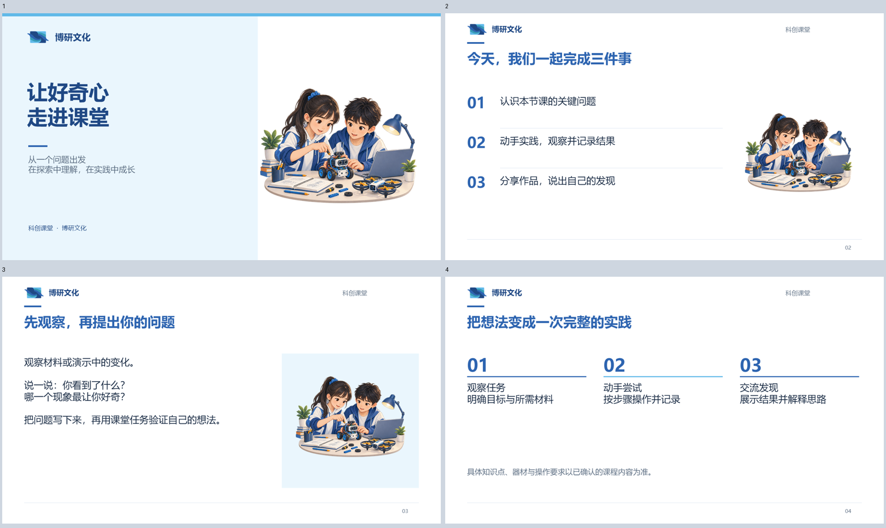
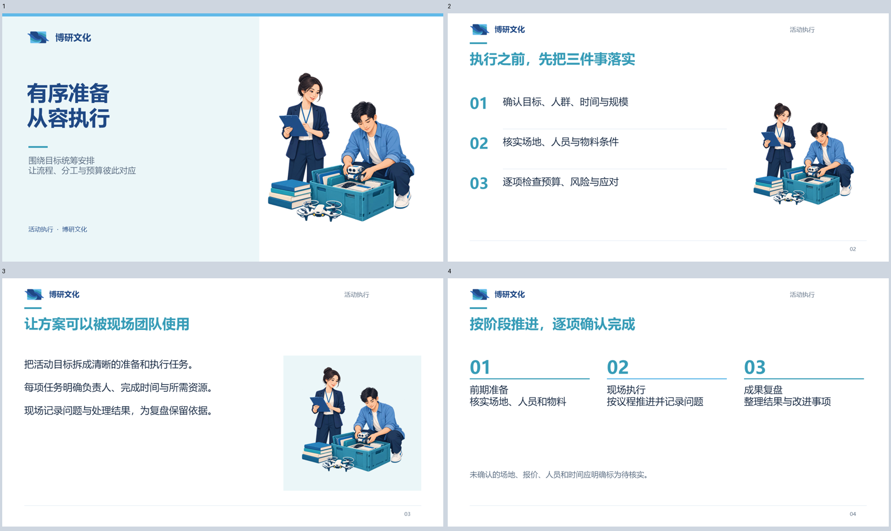

# PPT 模板与中文入口

## 设计依据

参考用户提供的《LiteBeeWing 第32节—火星探测》（33 页）和《第十六节课：鼠标、按键绑定（下）》（34 页），借鉴问题导入、章节转换、图文讲解、步骤、练习与回顾的教学节奏。两份原文件只读打开、逐页渲染，并核对原文件 SHA256 不变。没有复制其中的人物、摄影、课程代码或第三方图形，也没有将参考课件内容加入知识库。

原模板只有少量通用版式，实际生成器又反复使用三条文本页。新版同时更新模板与渲染器，避免仅修改静态示例。

## 三个场景，八种版式

| 场景 | 文件 | 设计方式 |
| --- | --- | --- |
| 教学 | `branding/templates/ppt-v2/teaching.pptx` | 浅蓝与深蓝，学生和科创器材插画；突出问题、实践、讨论与回顾 |
| 商务 | `branding/templates/ppt-v2/business.pptx` | 深蓝封面、留白正文；突出需求、合作范围、条件与下一步 |
| 活动执行 | `branding/templates/ppt-v2/operations.pptx` | 蓝与青色；突出任务、分工、准备、风险与复盘 |

每个模板含封面、目标与议程、图文讲解、步骤与流程、互动提问、对比与分工、原生表格、总结八页。标题、正文、编号、表格均可编辑；人物和器材为透明底 PNG，Logo 沿用 `branding/logo.png`。模板中的通用示例只是版式占位，不构成课程事实、商务承诺或总部报价。

`branding/templates/ppt-v2/layouts.json` 定义页索引与字段名；生成器按内容结构和章节选用版式，长内容分页，实际来源保留在备注及来源页。模板不能自动产生任意课题的专用代码截图、实验摄影或技术图解；这些内容需要有授权的素材和已核实的知识库依据。

## 版本与重新应用

旧 `branding/templates/` 的 12 份模板和 `boyan-v1` 清单不覆盖；`presets/boyan/v1`、`skills/boyan` 不改字节，保持已安装预设与历史交付物的校验兼容。PPT 的视觉版本单独存储为 `boyan-v2`，Word、Excel、Markdown 继续使用已有版本。

本机 `docker-compose.presets.yml` 设置 `BOYAN_PPT_TEMPLATE_VERSION=boyan-v2`。新提案将版本写入确认哈希；旧提案和旧下载继续使用其原版本。未知版本、缺少模板或哈希不一致时拒绝生成。该修改没有应用到云端或生产配置。

模板由 `scripts/build-ppt-templates.mjs` 使用 `@oai/artifact-tool` 构建，依赖通过运行环境提供，不能在没有依赖时把图片或旧文件伪装成新模板。构建要求：Node.js、`@oai/artifact-tool`、演示文稿技能目录和 Python 校验器。让 Node 能解析该包，并设置 `PRESENTATIONS_SKILL_ROOT`、`ARTIFACT_PYTHON`、`RUNTIME_NODE_MODULES` 后执行：

```powershell
node scripts/build-ppt-templates.mjs
```

构建会生成三份候选文件，通过完整性、字体、页尺寸、标题及原生表格校验后发布至模板目录并更新清单。重新构建后的 SHA256 会变化，需重建文档渲染镜像并重新验收。已有用户提案绑定某个视觉版本后，应以新的版本目录和版本号发布下一版，不再覆盖该版本；已确认提案的模板选择不可在生成时被静默替换。






## 插画来源

`branding/templates/ppt-v2/assets/` 中插画使用内置 imagegen 生成，非参考课件图片的截取或复刻。设计提示词要求真实透明背景、完整人物和物体、无文字与水印、海军蓝 `#1F4884`、中蓝 `#2D64B0`、浅蓝 `#60B9E8`，少量暖黄，平面编辑插画和轻微纹理。

| 文件 | 场景提示词主体 |
| --- | --- |
| teaching.png | 两名东亚学生协作制作轮式机器人，桌面有笔记本电脑与教育无人机；科学绘本风格，完整独立场景 |
| business.png | 三名东亚成年人围绕笔记本电脑、纸质方案与小型教育机器人讨论教育合作；专业温和的编辑插画 |
| operations.png | 女活动协调员拿记录板，男协作者整理教学机器人、教材与无人机；活动准备场景 |
| question.png | 独立的白蓝色轮式教育机器人，以思考姿态支撑提问页；不包含问号或文字 |

品牌标志没有通过模型重绘。素材没有添加任何业务事实。

## 验证入口

Agent 和 Skill 的操作方法、负例与通过标准见 [Agent 与业务技能验证](06-agent-skill-validation.md)。模板视觉检查与真实生成任务是两层验证；模板可打开不代表 Agent 产出已通过内容审校。

本次实际检查结果在完成本机部署和复测后追加。需要人工验证：讲师逐页检查知识点、授课节奏、课堂器材与年龄适配；商务负责人确认合作条款和对外表述；活动负责人确认当地条件和预算。自动审校不能替代这些专业判断。
