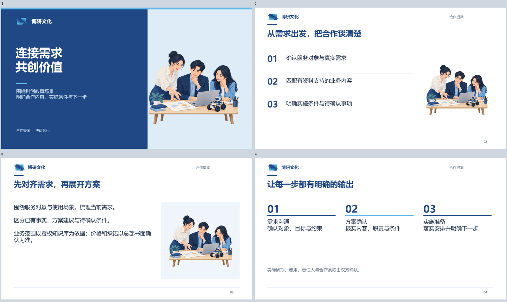

# PPT 模板与中文入口

## 设计依据

参考用户提供的《LiteBeeWing 第32节—火星探测》（33 页）和《第十六节课：鼠标、按键绑定（下）》（34 页），借鉴问题导入、章节转换、图文讲解、步骤、练习与回顾的教学节奏。两份原文件只读打开、逐页渲染，并核对原文件 SHA256 不变。没有复制其中的人物、摄影、课程代码或第三方图形，也没有将参考课件内容加入知识库。

原模板只有少量通用版式，实际生成器又反复使用三条文本页。新版同时更新模板与渲染器，避免仅修改静态示例。

## 三个场景，八种版式

| 场景 | 文件 | 设计方式 |
| --- | --- | --- |
| 教学 | `branding/templates/ppt-v2/teaching.pptx` | 浅蓝与深蓝，学生和科创器材插画；突出问题、实践、讨论与回顾 |
| 商务 | `branding/templates/ppt-v2/business.pptx` | 深蓝封面、留白正文；突出需求、合作范围、条件与下一步 |
| 活动执行 | `branding/templates/ppt-v2/operations.pptx` | 蓝与青色；突出任务、分工、准备、风险与复盘 |

每个模板含封面、目标与议程、图文讲解、步骤与流程、互动提问、对比与分工、原生表格、总结八页。标题、正文、编号、表格均可编辑；人物和器材为透明底 PNG，Logo 沿用 `branding/logo.png`。模板中的通用示例只是版式占位，不构成课程事实、商务承诺或总部报价。

`branding/templates/ppt-v2/layouts.json` 定义页索引与字段名；生成器按内容结构和章节选用版式，长内容分页，实际来源保留在备注及来源页。模板不能自动产生任意课题的专用代码截图、实验摄影或技术图解；这些内容需要有授权的素材和已核实的知识库依据。

## 版本与重新应用

旧 `branding/templates/` 的 12 份模板和 `boyan-v1` 清单不覆盖；`presets/boyan/v1`、`skills/boyan` 不改字节，保持已安装预设与历史交付物的校验兼容。PPT 的视觉版本单独存储为 `boyan-v2`，Word、Excel、Markdown 继续使用已有版本。

本机 `docker-compose.presets.yml` 设置 `BOYAN_PPT_TEMPLATE_VERSION=boyan-v2`。新提案将版本写入确认哈希；旧提案和旧下载继续使用其原版本。未知版本、缺少模板或哈希不一致时拒绝生成。该修改没有应用到云端或生产配置。

模板由 `scripts/build-ppt-templates.mjs` 使用 `@oai/artifact-tool` 构建，依赖通过运行环境提供，不能在没有依赖时把图片或旧文件伪装成新模板。构建要求：Node.js、`@oai/artifact-tool`、演示文稿技能目录和 Python 校验器。让 Node 能解析该包，并设置 `PRESENTATIONS_SKILL_ROOT`、`ARTIFACT_PYTHON`、`RUNTIME_NODE_MODULES` 后执行：

```powershell
node scripts/build-ppt-templates.mjs
```

构建会生成三份候选文件，通过完整性、字体、页尺寸、标题及原生表格校验后发布至模板目录并更新清单。重新构建后的 SHA256 会变化，需重建文档渲染镜像并重新验收。已有用户提案绑定某个视觉版本后，应以新的版本目录和版本号发布下一版，不再覆盖该版本；已确认提案的模板选择不可在生成时被静默替换。





## 插画来源

`branding/templates/ppt-v2/assets/` 中插画使用内置 imagegen 生成，非参考课件图片的截取或复刻。设计提示词要求真实透明背景、完整人物和物体、无文字与水印、海军蓝 `#1F4884`、中蓝 `#2D64B0`、浅蓝 `#60B9E8`，少量暖黄，平面编辑插画和轻微纹理。

| 文件 | 场景提示词主体 |
| --- | --- |
| teaching.png | 两名东亚学生协作制作轮式机器人，桌面有笔记本电脑与教育无人机；科学绘本风格，完整独立场景 |
| business.png | 三名东亚成年人围绕笔记本电脑、纸质方案与小型教育机器人讨论教育合作；专业温和的编辑插画 |
| operations.png | 女活动协调员拿记录板，男协作者整理教学机器人、教材与无人机；活动准备场景 |
| question.png | 独立的白蓝色轮式教育机器人，以思考姿态支撑提问页；不包含问号或文字 |

品牌标志没有通过模型重绘。素材没有添加任何业务事实。

## 验证入口

Agent 和 Skill 的操作方法、负例与通过标准见 [Agent 与业务技能验证](06-agent-skill-validation.md)。模板视觉检查与真实生成任务是两层验证；模板可打开不代表 Agent 产出已通过内容审校。

## 本次实际验证

2026-10-09，本机三个定制服务已更新；app、frontend、document-renderer、docreader、PostgreSQL、Redis、Ollama 共七个容器均为 healthy。没有连接阿里云或更新生产配置。

| 层次 | 结果 | 本机证据 |
| --- | --- | --- |
| 旧预设和指南 | 177 项静态检查通过，v1 文件保持原摘要 | `python scripts/check-presets.py` |
| 模板实物 | 三套共 24 页，完整性、字体、原生表格、PowerPoint 打开及逐页视觉检查通过 | `temp/ppt-design-chinese/native-templates/native-office.json` |
| 渲染器 | 最终镜像 25 项测试通过；覆盖双版本、八布局、原生表格、内容保全和长中文高度 | `temp/ppt-design-chinese/renderer-height-image-tests.log` |
| 场景样例 | 三份合成输入共 36 页，八版式均覆盖，原生 Office 打开及逐页检查通过 | `temp/ppt-design-chinese/native-renderer-final/native-office.json` |
| 真实长文重放 | A/B 原提案经修复后的渲染器输出 13/24 页，135 项内容保全检查通过；原生 Office 均无文字溢出 | `temp/ppt-design-chinese/height-replay/report.json`、`native-height-replay/native-office.json` |
| 真实 Agent 任务 | A/B 各完成检索、读取指南、提交大纲、系统确认、生成、C 审校及下载；最终两轮各 14 项自动检查通过 | `temp/ppt-design-chinese/live-ppt-a-final/report.json`、`live-ppt-b-revised/report.json` |
| 旧文件兼容 | 原 A/B 的 17/18 页 v1 PPT 仍能下载，摘要与旧交付一致；8 项检查通过 | `temp/ppt-design-chinese/old-downloads-verified/report.json` |
| 新入口与中文配置 | 83 项实际 API 检查、34 项浏览器检查通过；13 份提示词逐字匹配运行实例 | `temp/presets-acceptance/business-skills-audit.json`、`temp/business-skills-ui/2026-10-09T15-18-51-074Z/report.json` |

最终可下载的两份真实任务如下。数据库只读核对均为 `published`、`boyan-v2`，下载摘要与记录一致；两者均为 45 分钟。PowerPoint 原生打开、全部 37 页视觉检查及文本框溢出检查通过，另一伙伴下载同一任务得到拒绝。

| 伙伴 | 实际文件 | 页数 | SHA256 |
| --- | --- | --- | --- |
| A | [教学执行者入门培训](../temp/ppt-design-chinese/live-ppt-a-final/artifacts/a-artifact-courseware.pptx) | 13 | `4198446929e07469b5180b06f20e654e3e7f64c1103a737f314bcbc3b3762697` |
| B | [教学执行者入门培训](../temp/ppt-design-chinese/live-ppt-b-revised/artifacts/b-artifact-courseware.pptx) | 24 | `c0252f20ea5ca41e33f15baa6ad9ecd0f69651c4d1f657396f40f1a8e00c97ce` |

原生检查记录为 `temp/ppt-design-chinese/native-live-a-final/native-office.json` 和 `native-live-b/native-office.json`。B 的已发布文件在最后一次行高修复前生成，本身已经通过原生检查；修复后又对同一结构化正文离线重放并检查通过，未替换其已发布二进制。Word、Excel、Markdown 本轮没有重做真实任务，原验收记录仍在 `docs/04-presets.md`，不可将其旧结果称为新版重跑。

首次真实验收并非全部通过：A 的两个长中文框在原生 PowerPoint 中略超框，已修复 v2 行高估算、分页与实际写入使用不同计算的问题，重新确认并生成最终稿；B 首稿的逐节备注为 47 分钟，虽然模型 C 判通过，独立验收仍将其判失败，修订后为 45 分钟。旧报告保留在 `temp/ppt-design-chinese/live-ppt/report.json`，没有删除失败证据或放宽检查。这说明模型审校不能代替机械检查与讲师复核。

重新验证已有文件，不调用模型：

```powershell
pwsh -NoProfile -File scripts/verify-presets-office.ps1 -Report temp/ppt-design-chinese/live-ppt-a-final/report.json -OutputDirectory temp/ppt-design-chinese/office-recheck-a
pwsh -NoProfile -File scripts/verify-presets-office.ps1 -Report temp/ppt-design-chinese/live-ppt-b-revised/report.json -OutputDirectory temp/ppt-design-chinese/office-recheck-b
```

从头跑两个伙伴的真实任务会新增对话并调用当前模型；使用尚不存在的输出目录：

```powershell
python scripts/acceptance-presets.py --fixtures temp/presets-acceptance/fixtures.json --mode artifacts --artifact-case a-artifact-courseware --artifact-case b-artifact-courseware --output temp/ppt-design-chinese/new-live-run --stop-on-artifact-error --timeout 600
```

退出码 2 表示自动项通过但人工项未完成；退出码 1 表示存在失败，不能直接交付。真实模型输出存在随机性，不能保证每次无需修订。

需要人工验证：讲师逐页检查知识点、授课节奏、课堂器材与年龄适配；商务负责人确认合作条款和对外表述；活动负责人确认当地条件和预算。自动审校不能替代这些专业判断。

## 本机镜像记录

下列为本次 `docker image inspect` 返回的本机镜像 ID，不是已推送仓库的生产 digest 锁定记录。

| 镜像 | 本机 ID |
| --- | --- |
| `boyankb/app:v0.8.2-presets-v2` | `sha256:fd1655af909cd02f188da309adec3ab2e48083f8594bf35fc3e401fe2023feb4` |
| `boyankb/frontend:v0.8.2-presets-v2` | `sha256:b65cc328054f8bff332db185abc506b494aa0f55228ead5b93497ef493cfdaff` |
| `boyankb/document-renderer:boyan-v2` | `sha256:2bd6bdfbc30920d3c3f1fa44833d603e2906dc52cd52676419d152b8766cdcc3` |
